# Projeto Arminda: um tablet de jogos para quem amamos

> **Em memória da Arminda, a minha querida mãe.**

Este projeto nasceu de necessidade. A minha mãe, com 84 anos, nunca tinha usado um tablet. Fiz-lhe uma app de jogos simples, em Português, com um gato que fala, fotografias da família, a música dela e a casa dela em 360 graus porque tinha acesso a uma camera de 360 graus. Jogou todos os dias até ao fim. Esta pequena app foi tão boa ajuda que decidi publicar em formato livre para outros usarem.

Agora o projeto é de todos. Aqui está tudo o que é preciso para fazer um tablet assim para a pessoa que ama: a app, as ferramentas, e um caminho passo a passo, do tablet novo até, se quiser, um pequeno servidor da família.

Tudo o que é nosso é oferecido ao domínio público (CC0). Use, mude, partilhe. Não precisa de pedir nem de dizer de onde veio.

## O que vai ter no fim

- Um tablet Android que liga direto para os jogos e não sai de lá (modo quiosque). Os botões do Android não fazem nada; não há como se perder.
- 36 atividades: fotografias da família com os nomes ditos em voz alta, a música da pessoa, a casa dela em 360 graus, passeios em 360, e 32 jogos (cartas, dominó, loto, palavras, cozinha, feira, jardim, aquário, puzzles, damas, sueca, bisca e mais). Sem perder, sem tempo a contar, sem "fim de jogo". Os níveis sobem e descem sozinhos, sem a pessoa dar por isso.
- Um gato que diz tudo em voz alta: instruções, elogios, nomes das fotografias. Com a voz do computador, ou com vozes da família gravadas por si.
- Tudo a dizer o nome da pessoa: "Olá, avó!", "És um campeão!". Muda-se num só ficheiro.
- Opcional: um servidor da família, para ver de longe quanto jogou, a que horas, e a bateria do tablet. Os dados ficam no seu servidor.

## Como é

O ecrã inicial e a introdução: um botão só, e o gato a apresentar-se.

| | |
| --- | --- |
| 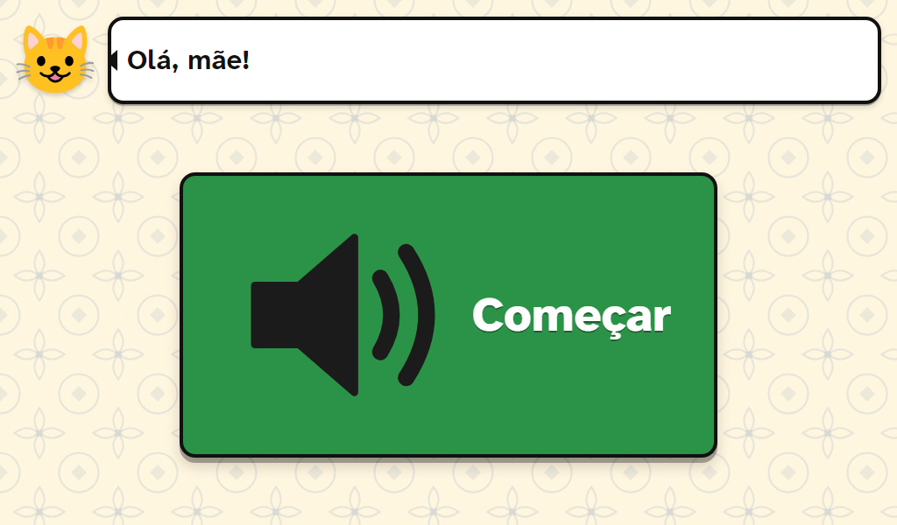 | 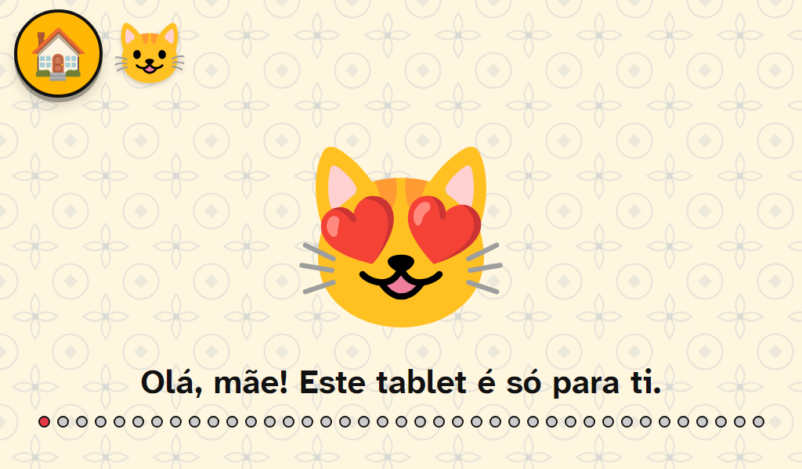 |

O ecrã dos jogos, doze de cada vez, com a seta para ver mais:

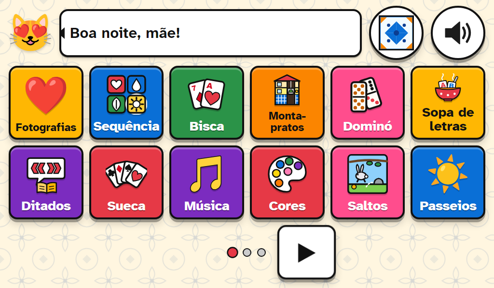

Alguns jogos. Tudo grande, com contornos fortes, e o gato a dizer o que fazer:

| | |
| --- | --- |
| 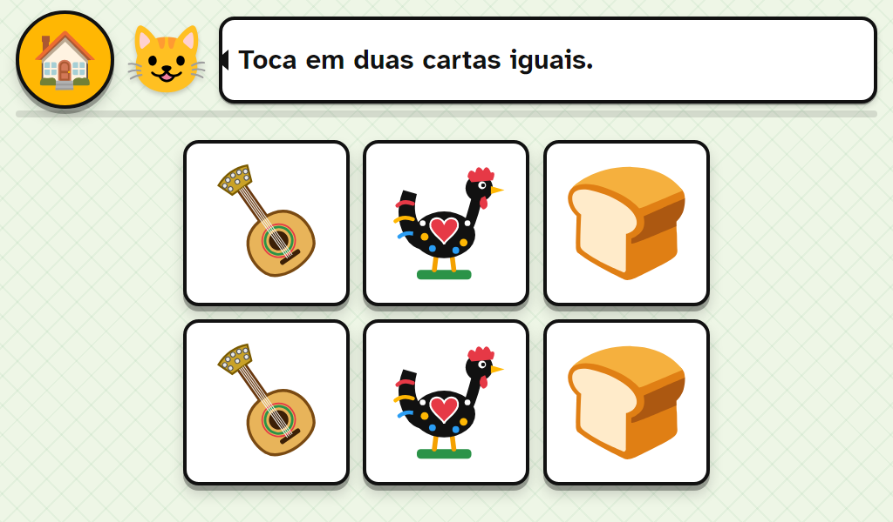 | 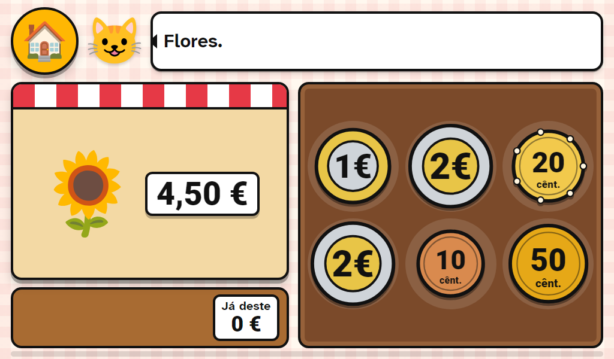 |
| 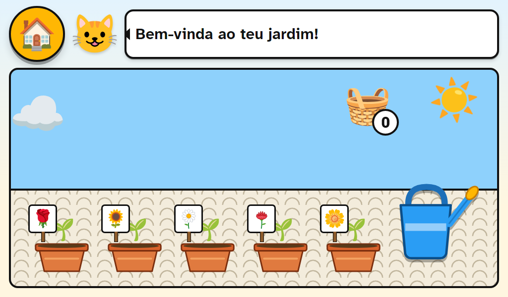 | 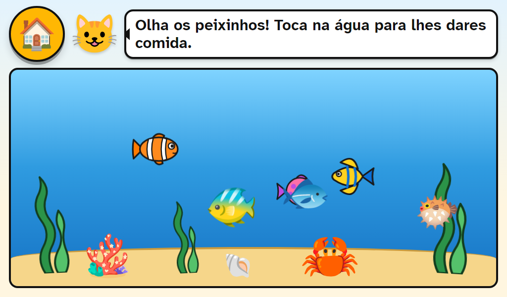 |
| 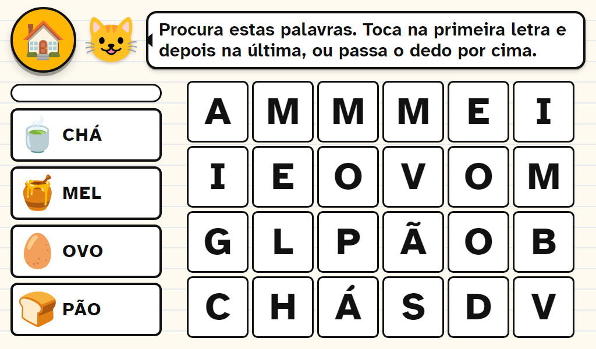 | 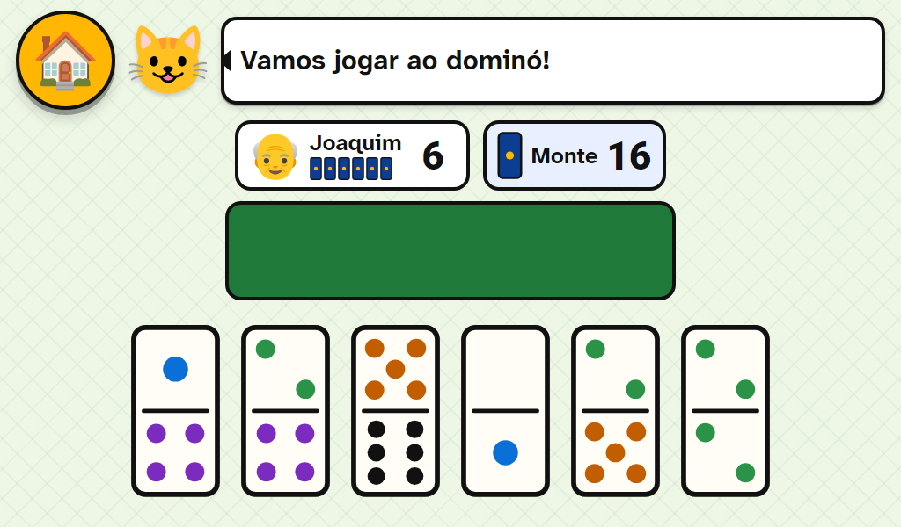 |
| 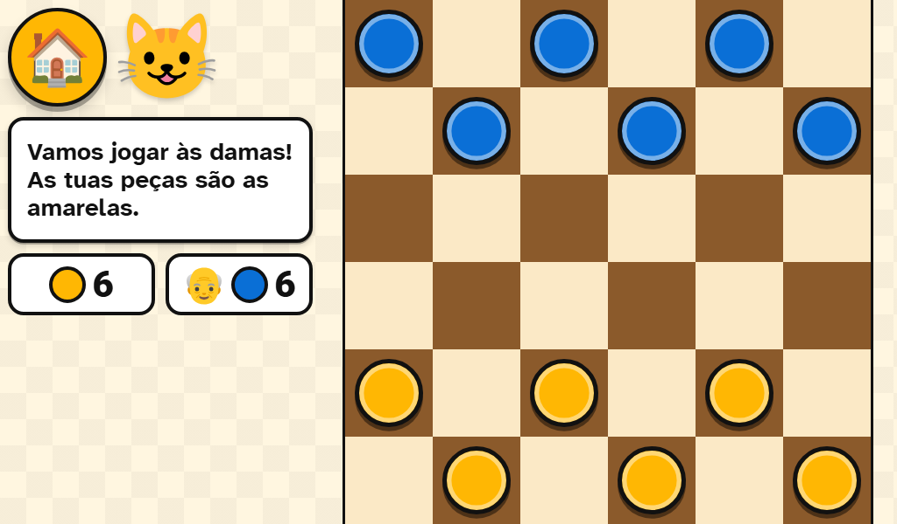 | 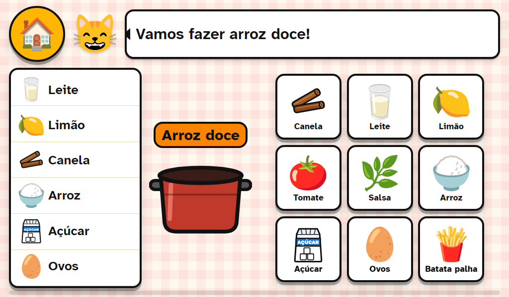 |
| 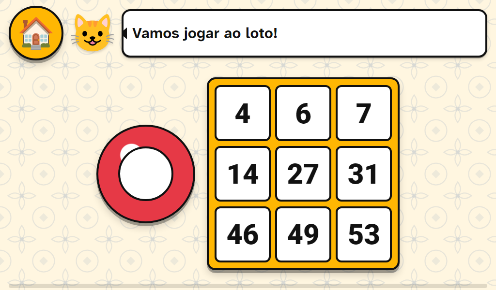 | 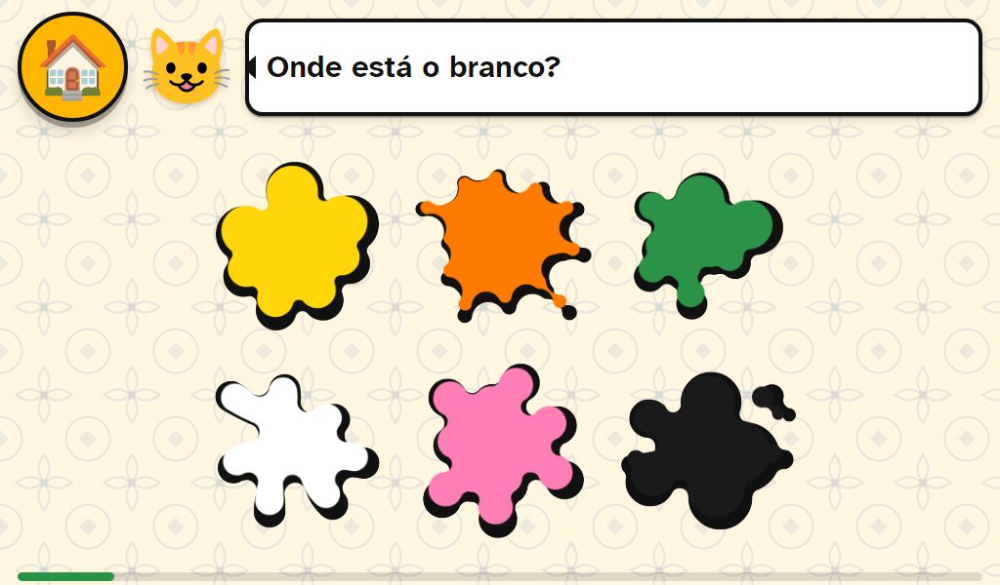 |

No fim de cada ronda, confetti, estrelas e um azulejo novo para o painel:

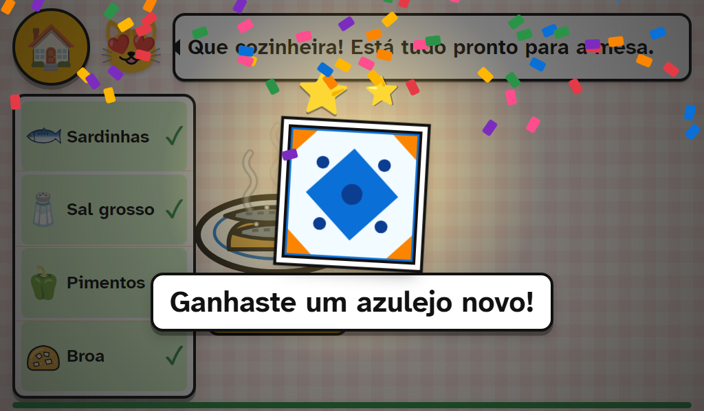

As fotografias da família, a música e a casa em 360 não estão aqui: são de cada família.

## Antes de começar

Precisa de saber usar um computador com Windows à vontade: instalar programas, abrir uma linha de comandos, editar um ficheiro de texto. Não precisa de saber programar. Cada passo diz exatamente o que escrever.

Conte com uma tarde para os passos 1 a 3, e outra para os passos 4 a 9. O servidor (passos 10 e 11) é para quem já tem um servidor ou quer ter.

## Os passos

Faça-os por ordem. Cada passo é uma coisa só, e termina com uma forma de ver que ficou bem.

| Passo | O quê | Resultado |
| --- | --- | --- |
| [PASSO_1](PASSO_1/README.md) | Escolher e preparar o tablet | Um tablet limpo, em português, pronto a ligar ao computador |
| [PASSO_2](PASSO_2/README.md) | Preparar o computador | Os programas instalados; `verificar_pc.ps1` diz que está tudo instalado |
| [PASSO_3](PASSO_3/README.md) | Obter o código e experimentar no computador | A app a correr no browser do seu computador |
| [PASSO_4](PASSO_4/README.md) | Dizer quem é a pessoa | O gato chama a pessoa pelo nome certo |
| [PASSO_5](PASSO_5/README.md) | A voz | Todas as frases ditas em voz alta; opcionalmente com vozes da família |
| [PASSO_6](PASSO_6/README.md) | Fotografias, música e a casa | Os conteúdos da pessoa preparados |
| [PASSO_7](PASSO_7/README.md) | Afinar os jogos e o ecrã | Jogos escolhidos, tamanhos certos para o tablet |
| [PASSO_8](PASSO_8/README.md) | Construir a app (APK) | Um ficheiro `.apk` pronto a instalar |
| [PASSO_9](PASSO_9/README.md) | Instalar no tablet e fechar em modo quiosque | O tablet liga direto para os jogos |
| [PASSO_10](PASSO_10/README.md) | O servidor da família (opcional) | Registos de jogo a chegar a um painel seu, com Docker Compose ou quadlets |
| [PASSO_11](PASSO_11/README.md) | Atualizações pela internet (opcional) | O tablet atualiza-se sozinho quando tem rede |
| [PASSO_12](PASSO_12/README.md) | O dia a dia | Bateria, o ecrã da família, cópias dos registos, problemas e soluções |

## O que está nesta pasta

| Pasta ou ficheiro | O que é |
| --- | --- |
| `app/` | A app: os jogos (HTML, CSS e JavaScript, sem frameworks), a parte Android (Capacitor 8) e as ferramentas em `app/tools/`. Os documentos técnicos lá dentro (`README.md`, `GUIA-JOGOS.md`, `CREDITOS.md`) são para quem programa. |
| `servidor/` | O servidor da família: o programa (Go, uma só pasta), `Dockerfile`, `compose.yaml`, `Caddyfile`, a versão em quadlet, e as ferramentas. |
| `PASSO_1/` a `PASSO_12/` | Os passos, um por pasta. |
| `AUDIO-LINHAS.md` | Todas as frases que o gato diz, secção a secção, para gravar vozes da família (passo 5). |
| `imagens/` | As capturas de ecrã desta página, tiradas da app no browser a 1024 por 600 com `app/tools/testes/lib/capturas_kit.mjs`. |
| `LICENSE` | CC0 1.0, no texto legal original, em inglês. |

## Onde mudar o quê

Tudo o que uma família costuma mudar está no início de um ficheiro, com um comentário. Os passos dizem qual.

| Para mudar | Ficheiro | Passo |
| --- | --- | --- |
| Como o gato trata a pessoa, o género, o título | `app/tools/falas.py` (`PESSOA`, `PESSOA_2`) | 4 |
| A voz do computador | `app/tools/voz/` (o modelo) e `LENTO` em `app/tools/gerar_voz.py` | 5 |
| Fotografias, música, casa em 360 | a pasta `media/` ao lado de `app/` | 6 |
| Que jogos aparecem e em que nível começam | `app/www/js/jogos/registo.js` | 7 |
| Tamanho mínimo do que se toca, páginas do ecrã inicial, letras e cores | `app/www/js/ui.js` (`ALVO_MIN`), `app/www/js/main.js` (`POR_PAGINA`), `app/www/css/app.css` (`:root`) | 7 |
| Minutos sem toque até o ecrã apagar | `MainActivity.java`, em `app/android/app/src/main/java/pt/mae/jogos/` (`QUIETO_PADRAO`, `APAGAR_NO_CARREGADOR`) | 7 |
| Segundos a segurar no gato para abrir o ecrã da família | `app/www/js/main.js` (`SEGURAR_GATO_MS`) | 7 |
| Quais as frases | `app/tools/falas.py` e `app/tools/falas/<jogo>.json` | 5 |
| O endereço do servidor e o token do tablet | `.SECRETS/SECRETS.txt` (nunca no git) | 10 |

## Créditos

O que é nosso (código, desenhos, textos, as frases do gato) é CC0. Estas partes de terceiros vêm dentro da app, cada uma com a sua licença, que fica dentro de `app/` ao lado dos ficheiros. A lista completa, ficheiro a ficheiro, está em `app/CREDITOS.md`.

| Parte | De quem | Licença |
| --- | --- | --- |
| Desenhos (emoji) em `app/www/img/noto/` | [Noto Emoji](https://github.com/googlefonts/noto-emoji), Google | Apache 2.0 |
| Manchas de tinta no jogo Cores | [Kenney, Splat Pack](https://kenney.nl/assets/splat-pack) | CC0 |
| Sons dos jogos (`app/www/snd/`) | [Kenney](https://kenney.nl/assets): Casino Audio, Interface Sounds, Music Jingles, Impact Sounds | CC0 |
| Quatro músicas de fundo | [OpenGameArt](https://opengameart.org): Aureolus_Omicron, Kistol, OwlishMedia | CC0 |
| Letra (tipo de letra) | [Atkinson Hyperlegible Next](https://github.com/googlefonts/atkinson-hyperlegible-next), Braille Institute | SIL Open Font License 1.1 |
| Visor de fotografias em 360 graus | [Pannellum](https://github.com/mpetroff/pannellum) 2.5.7, Matthew Petroff | MIT |
| A "casca" Android da app | [Capacitor](https://capacitorjs.com) 8, Ionic | MIT |
| Ditados e adivinhas | Tradição popular portuguesa | Domínio público |

O que não vem dentro da app, e cada família obtém por si (os passos dizem onde): a voz do computador ([Piper](https://github.com/OHF-Voice/piper1-gpl), GPL-3.0, e um modelo de voz com a sua própria licença), o Android SDK, o Node.js, o Java, o Python, o ffmpeg. As fotografias, músicas, gravações e nomes da sua família são seus e nunca saem do seu computador e do tablet, a não ser para o seu próprio servidor.

Tudo o que escrevemos está em português. Ficam na língua original, por não serem nossos: os textos das licenças, a biblioteca Pannellum, e os ficheiros que o Capacitor e o Gradle geram dentro de `app/android/`. Os nomes dos campos dos registos de jogo (`level`, `score`, `started_at`) também ficam em inglês: são o formato dos dados, e mudá-los estragava os registos já guardados.

## Licença

Este kit é dedicado ao domínio público com a licença [CC0 1.0](LICENSE). Pode fazer o que quiser com ele. Dado sem garantia: é um projeto de família, feito com cuidado, mas cada tablet e cada pessoa são diferentes. Não é um dispositivo médico nem um tratamento; são jogos e recordações.

Ligações verificadas a 10 de novembro de 2026.
